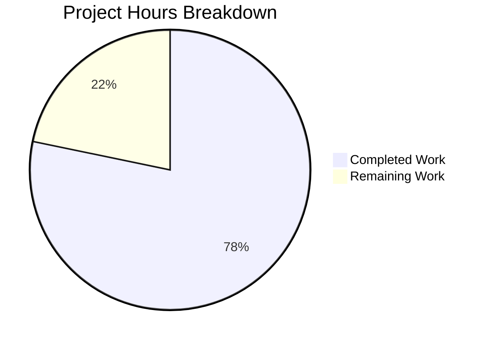

# 1. Executive Summary

## 1.1 Project Overview

hello_world is a single-file Node.js HTTP service: `server.js` answers every request on `127.0.0.1:3000` with HTTP 200 and the 14-byte body `Hello, World!\n`. Nothing pinned that contract, and `npm test` printed npm's placeholder and exited 1, so any edit could break consumers silently. This work adds `server.test.js` — two `node:test` cases pinning the status and the byte-exact body, for `GET /` and for a request differing in method and path — and points `npm test` at it. Two files change; the server is untouched.

## 1.2 Completion Status



**78% complete** — 18 of 23 hours delivered and verified. Completed work is shown in Blitzy dark blue (#5B39F3), remaining work in white (#FFFFFF).

| Metric | Hours |
|---|---|
| Total Hours | 23 |
| Completed Hours (AI + Manual) | 18 |
| Remaining Hours | 5 |

Formula: completed hours / total hours = (18 / (18 + 5)) × 100 = 78%. The components are itemised in Sections 2.1 and 2.2 and charted in Section 7.

## 1.3 Key Accomplishments

- Response contract pinned by two passing cases in `server.test.js`.
- Trailing line feed protected: a 13-byte body fails both cases.
- `POST /no-such-route` answered exactly as `GET /`; no 404 exists.
- `npm test` runs the suite: `ok 1`, `ok 2`, `# fail 0`, exit 0.
- The run terminates unaided, never hanging on the unclosable socket.
- Module under test byte-identical (`sha256 332fc2d0…`); no behaviour changed.
- Live contract confirmed on the wire: 200, `text/plain`, 14 bytes with the line feed.
- Nothing to install: two built-in modules, no dependency or configuration change.

## 1.4 Critical Unresolved Issues

Both scoped deliverables are complete and verified — 0 of 2 remain open. Eight follow-on items remain on the path to production; none is an undelivered requirement.

| Issue | Impact | Owner | ETA |
|---|---|---|---|
| Response headers are never asserted (`Content-Type` and runtime-owned headers) | A header regression would stay green | Repository owner | Next suite change |
| The status expectation cannot detect removal of the redundant `res.statusCode = 200` (`server.js:7`) | The contract is pinned in practice by the body assertion alone | Repository owner | Next suite change |
| The body is compared as decoded text rather than bytes | A future non-ASCII payload could pass a wrong byte sequence | Repository owner | If the body is ever localized |
| Loopback port 3000 is a host-global literal and cannot be partitioned | A concurrent holder makes the gate fail loudly (`EADDRINUSE` → `not ok`, exit 1) | Repository owner / CI operator | Before the gate runs in shared automation |
| No pipeline runs the gate | Regressions are caught only when someone runs `npm test` | Repository owner | Before the next release |
| The runtime floor is undocumented (no `engines` field may be added) | An older Node fails the gate with an unknown-option error | Repository owner | With the automation change |
| `package.json` `main` names `index.js`, which the repository does not contain | A consumer resolving the package by name finds no entry point | Repository owner | Low priority |
| No coverage figure exists or can be produced | Completeness rests on the two cases plus the wire evidence | Repository owner | Accepted by scope decision |

## 1.5 Access Issues

No access issues identified. Every command runs locally against the loopback interface; no credential, permission or external service is required.

## 1.6 Recommended Next Steps

1. [High] Run `npm test` as a required check, and document the Node release the suite needs (2h).
2. [High] On shared hosts, confirm loopback port 3000 is free before reading a red result.
3. [Medium] Decide the contract hardening: headers, status liveness, byte-level body (2h).
4. [Medium] Keep the suite at the two agreed cases.
5. [Low] Reconcile `main`, which names a file the repository does not contain (1h).

# 2. Project Hours Breakdown

## 2.1 Completed Work Detail

| Component | Hours | Description |
|---|---|---|
| Response-contract suite (`server.test.js`) | 8 | Two `node:test` cases pinning status `200` and the byte-exact 14-byte body, the module-scope load that starts the listener, the three prescribed one-line comments, and the exit-hook design (one event-loop turn, then an explicit exit) that a module exporting nothing requires. |
| Runnable project gate (`package.json`) | 3 | `scripts.test` set to `node --test server.test.js` with npm's placeholder removed, plus the acceptance run proving the project's own command and the direct command are one and the same invocation. |
| Contract verification campaign | 5 | Repeated runs of both commands, the per-case filter runs, bare discovery, deliberate-failure probes on throwaway copies (13-byte body, broken expectation, propagation through `npm test`), and independent wire probes including a real-browser byte check of both routes. |
| Module-of-record and tree integrity verification | 2 | Byte-identical `server.js` at its LF digest, the two-path change set, the absence of any install, lockfile change, configuration file or fixture, and evidence that runs leave the tree unchanged. |
| **Total** | **18** | |

## 2.2 Remaining Work Detail

| Category | Hours | Priority |
|---|---|---|
| Contract-protection hardening: assert the response header contract, make the status expectation meaningful, and compare the body as bytes | 2 | Medium |
| Gate production conditions: document the runtime floor, record an isolated-run procedure for hosts that share loopback port 3000, and add a required automation check that runs `npm test` | 2 | High |
| Package entry-point consistency: `main` names `index.js`, which the repository does not contain | 1 | Low |
| **Total** | **5** | |

Reconciliation: Section 2.1 (18h) + Section 2.2 (5h) = **23 total hours**, matching the Total Hours and Remaining Hours in Section 1.2 and the pie chart in Section 7.

One further item needs no estimated effort and is therefore not costed above: the untracked screenshot directory under `blitzy/` is housekeeping to delete or ignore once the evidence it holds has served its purpose.

# 3. Test Results

Every figure below was produced by running the suite and the probes in this checkout on Node v22.23.4 / npm 10.9.9. Coverage is not measured anywhere in this project: no coverage tool is configured and none may be added, so no coverage figure is claimed.

| Area / Category | Framework | Tests | Passed | Failed | Coverage | What This Proves |
|---|---|---|---|---|---|---|
| Response-contract suite (`server.test.js`) | `node:test` (built-in) | 2 | 2 | 0 | Not measured | `GET /` returns status `200` with the exact 14-byte body, and the handler's contract holds when the request differs. |
| Project gate (`npm test`) | npm → `node --test` | 2 | 2 | 0 | Not measured | The project's own command runs the same suite, reports `ok 1` / `ok 2` / `# tests 2 / # pass 2 / # fail 0` and exits 0. |
| Case isolation (`--test-name-pattern`, one run per case name) | `node:test` | 2 | 2 | 0 | Not measured | Each case selects and passes on its own (`1..1`, `# tests 1 / # pass 1 / # fail 0`). |
| Discovery (bare `node --test`) | `node:test` | 2 | 2 | 0 | Not measured | The root-level `*.test.js` convention is discovered by the runtime and runs both cases. |
| Deliberate-failure probes on scratch mirrors (13-byte body; broken expectation; the same breakage through `npm test`) | `node:test` | 6 | 0 | 6 (expected) | Not measured | A broken contract reports `not ok`, `# fail 2` and exit 1 — the exit hook masks nothing. |
| Live wire contract (curl byte capture; HEAD on another path; real-browser navigation of both routes) | curl.exe / Chrome DevTools | 5 | 5 | 0 | Not measured | HTTP 200, `Content-Type: text/plain`, `Content-Length: 14`, a 14-byte body including the line feed, identical for an unmatched method and path, with an empty console and no response at or above 400. |
| Port-contention behaviour (suite started while a listener held loopback 3000) | `node:test` | 2 | 0 | 2 (expected) | Not measured | Under contention the suite fails loudly (`EADDRINUSE` → `not ok 1`, `# fail 1`, exit 1) and never passes against a foreign listener. |

**Not Covered by any test.** The following are delivered or accepted capabilities that no test exercises; each is worth a human check before the gate is relied on in production.

- **Response headers.** `Content-Type` and every runtime-owned header are deliberately unasserted, so a future header change would leave the suite green.
- **The status line's own liveness.** Removing the redundant `res.statusCode = 200` (`server.js:7`) cannot be detected, because Node's `ServerResponse` already defaults to 200; the contract is pinned in practice by the body assertion.
- **Non-ASCII or differently encoded bodies.** The comparison is `await res.text()` against a text literal — byte-equivalent for this pure-ASCII payload, weaker for anything else.
- **Concurrency and repeated runs inside one process.** Each case issues a single request; sustained load, parallel requests and port reuse are not exercised.
- **Port contention as a designed test.** The behaviour is known from observation only; no test constructs a competing listener.
- **Any user interface or user journey.** The project has no HTML, style sheet, script or asset of any kind, so no screen, form or interaction could be validated; the browser evidence covers the plain-text document only.
- **Coverage.** No coverage tooling exists and none may be added, so no coverage percentage can be reported by anyone.

# 4. Runtime Validation & UI Verification

Each line below is behaviour observed on this host, on the running service or on the gate.

- ✅ **Server start-up** — `node server.js` binds `127.0.0.1:3000`, prints `Server running at http://127.0.0.1:3000/` and keeps running; listener ownership was confirmed as the started pid, and stopping that pid released the port.
- ✅ **`GET http://127.0.0.1:3000/`** — HTTP 200, `Content-Type: text/plain`, `Content-Length: 14`, body exactly `Hello, World!` plus one line feed (14 bytes, hex `48656c6c6f2c20576f726c64210a`).
- ✅ **`POST http://127.0.0.1:3000/no-such-route`** — the identical 200 and a byte-identical body; no 404, no error page.
- ✅ **Other methods and paths** — `HEAD /some/deep/path` → 200; the handler reads neither `req.method` nor `req.url`.
- ✅ **Project gate** — `npm test` → exit 0, `ok 1`, `ok 2`, `# tests 2 / # pass 2 / # fail 0`, self-terminating with the port released.
- ✅ **Suite commands** — `node --test server.test.js`, each per-case `--test-name-pattern` run, and bare `node --test` all exit 0 with the same two-case verdict.
- ✅ **Failure signal** — a 13-byte body or a broken expectation on a scratch mirror → `not ok 1`, `not ok 2`, `# fail 2`, exit 1, directly and through `npm test`.
- ✅ **Browser (real Chrome)** — both routes render the single line `Hello, World!`; raw body 14 bytes ending in the line feed; console empty; 9/9 requests returned 200 with none at or above 400; screenshots captured.
- ⚠ **Port contention** — with another listener on loopback 3000 the suite fails loudly (`EADDRINUSE` → `not ok 1 - server.test.js`, `# fail 1`, exit 1); recovery is to wait, re-check the port and rerun, never to signal a process you did not start.
- ❌ **Never exercised at runtime** — header assertions (none exist), concurrent or sustained request behaviour, execution from a pipeline (none is configured), and any UI flow (the project has no UI at all).

# 5. Compliance & Quality Review

## 5.1 Compliance Matrix

| Deliverable / Area | Benchmark | Status | Progress | Evidence |
|---|---|---|---|---|
| New test file at the repository root, CommonJS, beside the module it tests | Test asset exists, resolves and is discoverable | ✅ Pass | Complete | `server.test.js` (27 lines, 1041 B); discovered by bare `node --test` |
| Built-in runner and assertions only; no dependency, lockfile or configuration file | No new dependency or tooling | ✅ Pass | Complete | `server.test.js:1-2`; no dependency key in `package.json`; `npm ci` creates nothing |
| Exactly two cases pinning the contract, no more | Coverage fixed at the two agreed cases | ✅ Pass | Complete | `server.test.js:10,17`; every run reports `1..2` / `# tests 2` |
| Byte-exact body assertion protecting the trailing line feed | Comparison is exact, not trimmed or partial | ✅ Pass | Complete | `server.test.js:7,13,20`; a 13-byte body turns both cases red |
| Handler independence from method and path | A differing request is answered identically | ✅ Pass | Complete | `server.test.js:17-21`; live `POST` and `HEAD` probes returned 200 with the same 14 bytes |
| Self-terminating run lifecycle | The gate returns by itself with a pass/fail status | ✅ Pass | Complete | `server.test.js:24-27`; runs ended in 137–584 ms with both results reported |
| Minimal, accurate commentary | Comments minimal and true to the code beneath them | ✅ Pass | Complete | Comments only at `server.test.js:9,16,23`; no header block, banner or JSDoc |
| Single-field manifest change preserving key order and formatting | Smallest possible diff | ✅ Pass | Complete | `package.json:7`; numstat 1/1; the other six keys and the indentation are unchanged |
| Module under test untouched | No product behaviour changed | ✅ Pass | Complete | `server.js` at LF sha256 `332fc2d0…`; empty diff against the base commit |
| Project's own command runs the suite | The gate is reachable by the conventional command | ✅ Pass | Complete | `npm test` exit 0 with `ok 1`, `ok 2`, `# fail 0` |
| Unambiguous failure signal | A broken contract is visible and non-zero | ✅ Pass | Complete | `not ok` + `# fail 2` + exit 1 on scratch mirrors, direct and through `npm test` |
| Static analysis, measured coverage and a pipeline gate | Quality gates beyond the suite | ⚠ Gap | Not present; carried in the remaining 5 hours | No coverage, lint, type-check or pipeline gate exists, and none may be added inside the agreed scope |

## 5.2 AAP & Rule Divergences and Gaps

No user-specified rules were provided for this project, so every divergence below is measured against the agreed scope. Where a change of direction was already sanctioned by the agreed scope itself, the table marks it **Sanctioned**.

| What the AAP/Rule Required | What Was Delivered Instead | Why It Diverged | Impact | Remediation |
|---|---|---|---|---|
| Run a linter over each modified file before delivery | No linter was run; `node --check` (exit 0 on both files) and a JSON parse stood in | **Sanctioned** — the project has no linter, no lint configuration and no `node_modules`, and the agreed scope forbids introducing any dependency or tooling | None on the delivered files; the project still has no lint gate, and none was invented | None required. Adding linting is a new decision, not a repair |
| Use the environment recorded in the plan (Node v22.23.3 / npm 11.21.0) | Node v22.23.4 / npm 10.9.9 ran the suite and the gate | The repository pins no runtime, and installing or switching one is forbidden; the plan itself directs confirming on the runtime actually present | Documentation only — no delivered file states a version, and every capability the gate needs is present | Correct the version wherever it is documented, or pin one deliberately as a separate 1h decision |
| Run acceptance inside the repository; keep discovery to `server.js` and `package.json` | The manifest change was committed before the suite landed in that checkout, so its acceptance ran on a byte-identical scratch mirror, and the known path was polled for the suite's arrival | The two deliverables were produced concurrently; the mirror was byte-identical to the repository | The original acceptance evidence was not produced in the shared tree | Closed — `npm test` in the repository now reports `ok 1`, `ok 2`, `# fail 0`, exit 0 |
| Fix coverage by decision: the two cases are the whole suite; no coverage tooling, threshold or figure | Exactly that — the project ships with no coverage tool, no threshold and no coverage figure | **Sanctioned** — the agreed scope forbids adding coverage tooling, and coverage of a module that runs inside the child process the runner spawns could not be attributed anyway | Quality completeness cannot be quantified; the strongest evidence is the acceptance run plus the wire probes | None in scope. Measuring coverage is a separate decision |
| Two assertions per case on status and body; no header assertion | Precisely that: four assertions, no header or timing assertion | **Sanctioned** — the request fixed coverage at two cases and excluded header assertions | Three classes of regression stay green: header changes, removal of the redundant `res.statusCode = 200`, and a non-ASCII body whose bytes differ from its decoding | 2h hardening task: assert the header contract, make the status expectation meaningful, compare bytes |
| `index.js` is out of scope: not created, not read, not probed | The field was left as it was: `main` still names `index.js` | The file pre-dates this work and the agreed scope excludes it | A consumer resolving the package by name finds no entry point; `npm test` never loads `main`, so the gate is unaffected | 1h: create the entry file or repoint `main` at the module that exists |
| The change set is exactly two files; nothing else is added | The two-file change set holds; the checkout's working tree also carries four untracked PNGs under `blitzy/screenshots` | **Sanctioned** — browser validation writes screenshots to that platform evidence location, and they must remain untracked rather than committed | None on the committed change set; a `git status` shows an untracked directory | Delete or ignore the directory once the evidence is no longer needed |

**Linter substitution.** The change discipline for this repository asks for a linter pass over every modified file. Nothing in the project can satisfy that as written: there is no linter binary, no lint configuration and no `node_modules`, and the agreed scope forbids adding any tooling or package. The substitution was `node --check server.test.js` and `node --check server.js`, both exit 0, plus a parse of `package.json` — the strongest static checks the runtime offers for two files this small. The reader inherits a project with no lint gate and should not read its absence as an omission: it is a deliberate consequence of the no-dependency posture, and adding linting would mean adding a dependency as its own decision.

**Environment record.** The plan's environment table records Node v22.23.3 and npm 11.21.0; the machine that ran the gate has Node v22.23.4 and npm 10.9.9. Nothing in either delivered file states a runtime version, `package.json` pins none (no `engines`, `volta` or `nvm` key), and switching runtimes is forbidden for this environment, so the record is the only place this could ever have matched. Every capability the suite needs — `node:test`, `node:assert/strict`, global `fetch` and explicit-path `node --test` — is present on the installed release, and both the suite and the gate are green on it. The correction belongs in documentation, or in a deliberate `engines` field, which is a separate 1h decision recorded in Section 2.2.

**Acceptance provenance.** The manifest's change and the test suite were produced in parallel, and the manifest's change was committed before the suite existed in that checkout. Its acceptance run therefore executed against a byte-identical scratch mirror — the real manifest, the untouched `server.js` and the agreed test file — rather than in the shared tree, and the known path was checked while waiting for the suite to land. The same acceptance is now reproduced in the repository: `npm test` reports `ok 1`, `ok 2`, `# tests 2 / # pass 2 / # fail 0` and exits 0. Nothing is outstanding, and a reader should read this as delivery sequencing rather than as an unresolved gap.

**Coverage position.** Coverage here is a decision, not a target: the two named cases are the whole suite, and no coverage tool, threshold, report or percentage figure is introduced or claimed. That departure from the usual enterprise expectation is deliberate and load-bearing — a coverage tool would mean a registry dependency, a configuration file and a build step, each of which the agreed scope excludes. It also could not have answered the question a reader would ask it: `server.js` executes inside the child process the test runner spawns, so the runner could not attribute line coverage to the module under test even if a tool were installed. The practical consequence is that completeness rests on the two assertions plus the independent wire evidence in Section 4, not on a number.

**Protection breadth accepted.** The suite asserts exactly two things per case — the status code and the complete body — because the request fixed coverage at two cases and excluded header assertions. Three consequences were accepted with that decision and are visible in the code: a change to `Content-Type` would leave the suite green; deleting the redundant `res.statusCode = 200` at `server.js:7` would also leave it green, because Node's `ServerResponse` already defaults to that status; and the body is compared as decoded text, which is byte-equivalent for this 14-byte ASCII payload but would be weaker for a localized one. None of these is a defect in the delivered suite — each is the price of the requested minimality, and the 2h hardening task in Section 2.2 is where a team that wants the wider protection should spend it.

**Package entry point.** `package.json` still declares `"main": "index.js"`, and the repository contains no `index.js`; it never has. The agreed scope named that file out of bounds — not created, not read, not probed — so the field was left exactly as it was, and the gate is unaffected because `npm test` never loads `main`. The practical exposure is for anyone who installs or requires the package by name: resolution fails. One hour of work closes it, either by creating a small entry module that starts the server or by repointing `main` at `server.js`; the choice is a product decision, which is why it is left to the reader.

**Untracked evidence.** The agreed change set is exactly two files, and it is: `git diff --name-status` against the base commit shows `M package.json` and `A server.test.js` and nothing else. The working tree nonetheless carries four untracked PNGs under `blitzy/screenshots`, written there by browser validation of the response contract, because that directory is the platform's designated evidence location and the guidance for this environment requires it to stay untracked rather than committed. The consequence is cosmetic — a `git status` shows an untracked directory — and the remediation is to delete or ignore it once the screenshots have served their purpose. Nothing in the delivered change set depends on those files.

# 6. Risk Assessment

Risks below are forward-looking: what could still go wrong in production, with the mitigation available and its current status. Severity and probability are judgement calls anchored in the observations in Sections 3 and 4.

| Risk | Category | Severity | Probability | Mitigation | Status |
|---|---|---|---|---|---|
| A change to the response headers goes undetected — `Content-Type` and runtime-owned headers are never asserted | Technical | Medium | Medium | Extend the suite to assert the header contract before the response is consumed by anything new | Open (accepted caveat) |
| Assertion-strength caveats: removing the redundant `res.statusCode = 200` leaves the suite green, and a `--test-name-pattern` that matches no case still exits 0 reporting the test file itself | Technical | Low | Medium | Treat the body assertion as the pin for the contract, and require that any filtered run's output names the case it ran | Open (accepted caveat) |
| The body is compared as decoded text rather than bytes | Technical | Low | Low | Compare raw bytes if the payload is ever localized or re-encoded | Open (accepted caveat) |
| No coverage figure exists or can be produced | Technical | Low | High (certain) | None available inside the agreed scope; completeness rests on the two cases plus the independent wire probes | Accepted by scope decision |
| Loopback port 3000 is a host-global literal and cannot be partitioned: a concurrent holder makes the gate fail loudly (`EADDRINUSE` → `not ok 1 - server.test.js`, `# fail 1`, exit 1) | Operational | Medium | High on a shared host | Confirm the port is free before reading a red result, isolate the run, and rerun; never signal a process you did not start | Open |
| No pipeline runs the gate, so a broken contract is caught only when someone runs `npm test` | Operational | Medium | High | Run `npm test` as a required check on every change | Open |
| The runtime floor the suite needs (`node:test`, `node:assert/strict`, global `fetch`) is documented nowhere, and no `engines` field may be added inside the agreed scope | Operational | Low | Medium | Document the required Node release, or pin one deliberately as its own change | Open |
| `package.json`'s `main` names `index.js`, which the repository does not contain | Integration | Low | Medium | Create the entry file or repoint `main` at the module that exists | Open |

**Security.** This change adds no security exposure: no dependency, no credential or secret, no non-loopback address, and no path by which untrusted input reaches execution, a query, a file path or a template — the listener answers a compile-time constant on the loopback interface. The residual is the deliberately unhardened listener (`server.js` registers no `error` handler, has no configurable bind and no shutdown handling), which the agreed scope excludes; for a loopback-only constant-response service the exposure is Low with Low probability, and hardening it would be a separate product decision rather than a repair.

# 7. Visual Project Status

Completed work is shown in Blitzy dark blue (#5B39F3) and remaining work in white (#FFFFFF); the chart carries the same figures as Sections 1.2 and 2.2.


| Remaining work by category | Hours |
|---|---|
| Contract-protection hardening (headers, status-line liveness, byte-level body comparison) | 2 |
| Gate production conditions (runtime floor, isolated-run procedure, automation check) | 2 |
| Package entry-point consistency (`main` → a file that exists) | 1 |
| **Total** | **5** |

Total project hours 23: 18 completed (78%) and 5 remaining. Remaining hours are dominated by the two Medium-priority categories — making the contract harder to break silently, and putting the gate where it actually runs on every change.

# 8. Summary & Recommendations

The project now has a regression gate over its only product behaviour. Two files changed: `server.test.js` adds two `node:test` cases that pin HTTP `200` and the byte-exact 14-byte body — one for `GET /`, one for a request differing in method and path — and `package.json` points `npm test` at that file instead of printing npm's placeholder and exiting 1. The module under test is byte-identical at its recorded digest, so nothing about the service's behaviour changed; what changed is that the behaviour is now asserted. Of the 23 hours in scope, 18 are delivered and verified, leaving 78% complete.

Everything claimed here was produced by running the code. Both commands (`npm test` and `node --test server.test.js`), each per-case filter run and bare discovery exit 0 with `ok 1`, `ok 2`, `# tests 2`, `# pass 2`, `# fail 0`; the run ends by itself in roughly 0.2–0.6 seconds and releases the port. The failure direction was proven on scratch mirrors rather than assumed: a body trimmed to 13 bytes, or a broken expectation, produces `not ok 1`, `not ok 2`, `# fail 2` and exit 1, directly and through `npm test`, so the exit hook cannot hide a broken contract. The live service was probed independently with curl, a raw client and a real browser: `200`, `text/plain`, `Content-Length: 14`, a 14-byte body ending in the line feed, byte-identical on an unmatched method and path, with an empty console.

What remains is small but real, and it is about where the gate runs rather than whether it works. The critical path is the 2h production item: document the Node release the suite needs, record the procedure for running it on a host that shares loopback port 3000 (check the port, and on `EADDRINUSE` wait and rerun instead of signalling another process), and run `npm test` as a required check so a broken contract cannot reach the default branch unnoticed. In parallel, a 2h decision covers the protection breadth the agreed scope left open — assert the header contract, make the status expectation meaningful, and compare the body as bytes — and 1h reconciles `package.json`'s `main`, which names an `index.js` the repository does not contain.

Success criteria for the change are met and measurable: the project's own command runs the suite and exits 0; a broken contract goes red with a non-zero status; the suite introduces no dependency, lockfile change or configuration file; the two cases are the whole suite, as the request fixed; and repeated runs leave the working tree unchanged. The one criterion that cannot be met is a coverage figure, because no coverage tooling exists and none may be added — completeness rests on the two assertions plus the wire evidence, and that trade-off is documented rather than hidden.

Production readiness: **ready** as a developer-run gate, and **ready with the two High-priority conditions above** before it is relied on inside automation on a shared host. There is no security exposure in the change at all — no dependency, no credential, no non-loopback address, no untrusted input path. The most useful next action is the smallest one: put `npm test` in a required check, and tell whoever reads a red result to look at the port before they look at the suite.

# 9. Development Guide

Every command below was executed in this checkout on Node v22.23.4 / npm 10.9.9 and its output observed. Commands are written for Windows PowerShell (the shell this project is built and tested on); `node`, `npm` and `curl.exe` behave the same in any shell.

## System Prerequisites

- **Node.js on PATH.** The suite needs `node:test`, `node:assert/strict`, global `fetch` and explicit-path `node --test <file>` — Node 18 or newer supplies all four; this project was verified on **v22.23.4** with npm **10.9.9**. Nothing else is required: no compiler, container, database, message broker or service.
- **A free loopback port 3000.** The service and the suite both bind `127.0.0.1:3000`, and the suite must run on the same host as the server it starts.
- **No credentials and no environment variables.** `server.js` reads no configuration (`process.env` appears nowhere in it); the host and port are source literals.

## Environment Setup and Dependency Installation

There is no virtual environment, no install step and no build step. The package declares zero dependencies, so there is nothing to fetch and no `node_modules` is created.

```powershell
cd <repository-root>
npm ci
```

Expected: `up to date in <n>ms`, exit 0, and **no** `node_modules` directory afterwards. The compile-equivalent check, since the project has no compiler or bundler:

```powershell
node --check server.js          # exit 0
node --check server.test.js     # exit 0
```

## Pre-flight: Is the Port Free?

```powershell
Get-NetTCPConnection -LocalPort 3000 -State Listen -ErrorAction SilentlyContinue
```

No rows means the port is free. If a row appears, another process holds it — wait for it to release, re-check, and only then start or rerun. Never stop a process you did not start.

## Application Startup

```powershell
$p = Start-Process node -ArgumentList 'server.js' -PassThru -NoNewWindow `
     -RedirectStandardOutput server.out.log -RedirectStandardError server.err.log
Start-Sleep -Milliseconds 800
Get-Content server.out.log
```

Expected: `Server running at http://127.0.0.1:3000/`, and the process keeps running (it never exits on its own). Confirm the listener belongs to the pid you started:

```powershell
(Get-NetTCPConnection -LocalPort 3000 -State Listen).OwningProcess   # should be $p.Id
```

Stop it with that captured pid:

```powershell
Stop-Process -Id $p.Id
```

## Verification Steps and Example Usage

```powershell
curl.exe -sS -o body.bin -w "%{http_code}`n" http://127.0.0.1:3000/
(Get-Item body.bin).Length                  # 14
Format-Hex body.bin                         # 48 65 6C 6C 6F 2C 20 57 6F 72 6C 64 21 0A
```

Expected: `200` and a body of `Hello, World!` followed by one line feed — 14 bytes, hex `48656c6c6f2c20576f726c64210a`.

```powershell
curl.exe -sS -o post.bin -w "%{http_code}`n" -X POST http://127.0.0.1:3000/no-such-route
```

Expected: `200` with a byte-identical body. There is no routing: any method and any path receive the same response, and a 404 never appears. Response headers are `HTTP/1.1 200 OK`, `Content-Type: text/plain`, `Content-Length: 14`.

Run the suite — the same invocation the project's own command uses:

```powershell
npm test                                                    # exit 0
node --test server.test.js                                  # exit 0
node --test --test-name-pattern="GET / returns status 200 and the exact body" server.test.js
node --test                                                 # bare discovery of the root-level *.test.js
```

Expected from `npm test`, run from the repository root:

```text
> hello_world@1.0.0 test
> node --test server.test.js

TAP version 13
# Server running at http://127.0.0.1:3000/
ok 1 - GET / returns status 200 and the exact body
ok 2 - POST to an unmatched path returns the same status and body
1..2
# tests 2
# suites 0
# pass 2
# fail 0
```

Each per-case filter run reports `1..1`, `# tests 1 / # pass 1 / # fail 0`. The run terminates by itself in roughly 0.2–0.6 seconds and releases the port.

## Common Issues and Resolution Paths

| Symptom | Cause | Resolution |
|---|---|---|
| `Error: listen EADDRINUSE: address already in use 127.0.0.1:3000`, reported as `not ok 1 - server.test.js`, `# fail 1`, exit 1 | Another process holds the loopback port | Wait a moment, re-check with `Get-NetTCPConnection`, rerun. Do not signal a process you did not start — a red run during contention is a port conflict, not a broken suite |
| The run prints both results and then never returns | The `after()` hook's `process.exit(0)` is gone; the listening socket cannot be closed because `server.js` exports nothing | Restore the exit in the `after()` hook, or interrupt the run with the pid you started |
| A failing case reports `# tests 1 / # pass 1 / # fail 0` with exit 0 | The event-loop turn (`setImmediate`) before the exit was dropped, so the last case's result never reaches the reporter | Restore `await new Promise((resolve) => setImmediate(resolve));` ahead of `process.exit(0)` |
| A filtered run exits 0 but no named case appears in the output | A `--test-name-pattern` that matches nothing still exits 0, reporting the test file itself | Check that the output names the case you meant to run |
| A digest check over `server.js` disagrees with the recorded value | The checkout converts line endings (CRLF on disk, LF in the committed blob) | Hash the committed blob, or normalize line endings before hashing. The `\n` inside the asserted body literal is a JavaScript escape and still produces a real line feed on the wire |
| A consumer requiring the package by name fails to resolve it | `package.json`'s `main` names `index.js`, which the repository does not contain | Not used by `npm test`; create the entry file or repoint `main` (see Section 2.2) |

## Evidence Locations

Browser validation of the response contract writes untracked screenshots to `blitzy/screenshots/`; the directory is the designated evidence location and is deliberately left untracked. Everything else the commands above produce stays in your working directory, and none of them modifies a tracked file.

# 10. Appendices

## A. Command Reference

All commands run from the repository root unless noted.

| Purpose | Command |
|---|---|
| Run the project's gate | `npm test` |
| Run the suite directly | `node --test server.test.js` |
| Run one case | `node --test --test-name-pattern="GET / returns status 200 and the exact body" server.test.js` |
| Discover the suite | `node --test` |
| Parse check (no build step exists) | `node --check server.js` / `node --check server.test.js` |
| Confirm nothing needs installing | `npm ci` (exit 0, creates no `node_modules`) |
| Start the service | `$p = Start-Process node -ArgumentList 'server.js' -PassThru -NoNewWindow -RedirectStandardOutput server.out.log -RedirectStandardError server.err.log` |
| Stop the service | `Stop-Process -Id $p.Id` |
| Probe the contract | `curl.exe -sS -o body.bin -w "%{http_code}`n" http://127.0.0.1:3000/` |
| Check the loopback port | `Get-NetTCPConnection -LocalPort 3000 -State Listen` |

## B. Port Reference

| Port | Binding | Owner | Purpose | Notes |
|---|---|---|---|---|
| 3000 | TCP, `127.0.0.1` (loopback only) | `server.js` (`const port = 3000`) | The single HTTP endpoint the suite targets and the service serves | Host-global and not configurable: a concurrent holder fails the run loudly with `EADDRINUSE` rather than silently passing against a foreign listener |

No other port, socket, service, database, queue or cache is used by this project.

## C. Key File Locations

| Path | Role |
|---|---|
| `server.js` | The service under test — read-only for this work, byte-identical at LF sha256 `332fc2d04eb5b8f3cb230855457af80d0dfc246f958d6e49615610d656acc2e0` |
| `server.test.js` | The response-contract suite: 27 lines, two cases, four assertions, the module-scope load and the `after()` exit hook |
| `package.json` | Manifest; `scripts.test` = `node --test server.test.js`; `main` still names `index.js`, which the repository does not contain |
| `package-lock.json` | Pre-existing and unchanged; declares no dependency |
| `README.md` | Pre-existing and unchanged; its text predates this work and is unrelated to it |
| `blitzy/screenshots/` | Untracked browser evidence captured during contract validation |

## D. Technology Versions

| Component | Version | Requirement |
|---|---|---|
| Node.js | v22.23.4 (verified) | Node 18 or newer — supplies `node:test`, `node:assert/strict`, global `fetch` and `node --test <path>` |
| npm | 10.9.9 (verified) | Only to run the project's own test script |
| `node:test`, `node:assert/strict`, global `fetch` | Shipped with the runtime | Built in; nothing to install or pin |
| Third-party dependencies | None | None is declared, installed or permitted by this change |

## E. Environment Variable Reference

| Variable | Required | Notes |
|---|---|---|
| *(none)* | No | `server.js` reads no configuration (`process.env` appears nowhere in it); host and port are source literals, the suite reads no environment variable, and `npm test` needs none. The run passes with the environment unchanged. |

## F. Developer Tools Guide

- **Shell.** PowerShell 5.1 on this host; every command in Section 9 also works in any shell able to run `node`, `npm` and `curl`.
- **Runtime.** Any Node release that satisfies the floor in D. There is no version manager, lockfile dependency or toolchain to install.
- **Test runner.** The runtime's built-in `node:test`, invoked by explicit path; there is no runner configuration file, glob, reporter, timeout or concurrency setting, and none is needed.
- **Static checks.** The project configures no linter, formatter, type checker, bundler or coverage tool, and none was added. `node --check` is the only static check available for the two JavaScript files; `package.json` parses as JSON.
- **Continuous integration.** None is configured; wiring `npm test` into a required check is the first item in Section 2.2.
- **Evidence.** Contract screenshots from browser validation live in the untracked `blitzy/screenshots/` directory.

## G. Glossary

| Term | Meaning |
|---|---|
| Contract | What the service guarantees: HTTP `200` with `Content-Type: text/plain` and the 14-byte body `Hello, World!\n` |
| Gate | The project's own command, `npm test`, which runs the suite and returns a pass/fail exit status |
| Byte-exact | Compared as the complete byte sequence including the trailing line feed; a trimmed body fails the suite |
| `EADDRINUSE` | "Address already in use" — another process holds loopback port 3000, so the run fails before any request is made |
| Exit hook | The `after()` callback in `server.test.js` that yields one event-loop turn and then ends the process, because the listening socket can never be closed |
| TAP | The text format `node:test` writes: `ok` / `not ok` lines plus `# tests`, `# pass` and `# fail` counts |
| `--test-name-pattern` | A runner option that selects cases by name; a pattern matching nothing still exits 0, so the output must name the case it ran |
